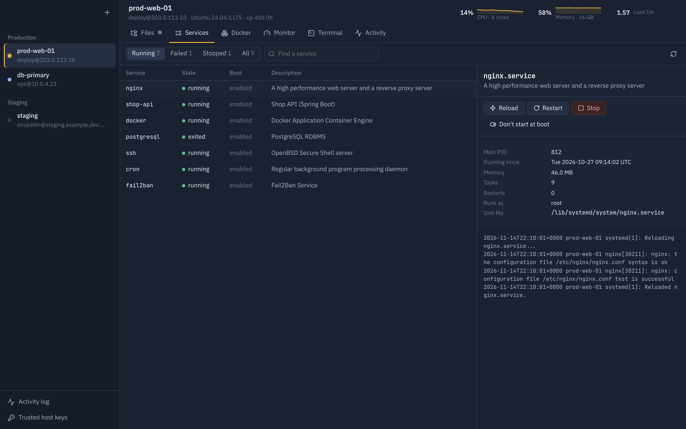
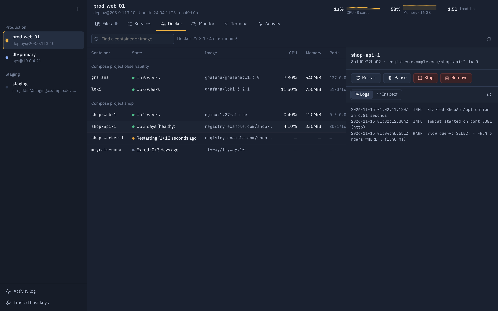
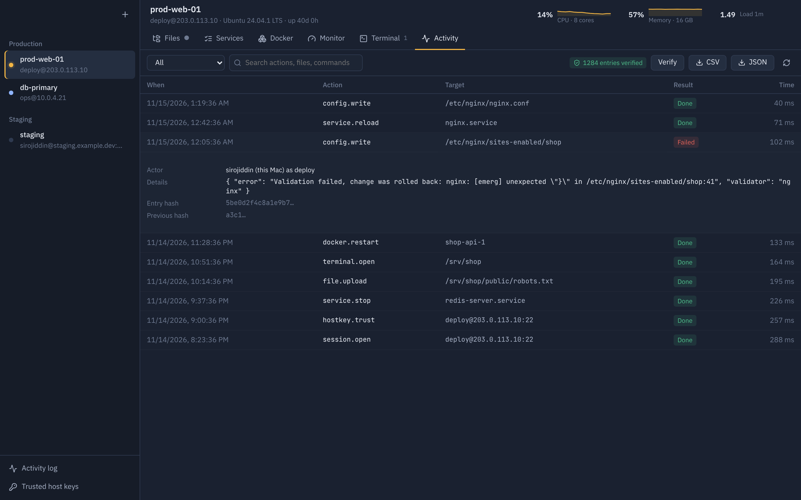

<p align="center"></p>

<h1 align="center">Outpost</h1>
<p align="center">The modern server workbench for macOS: files, configs, services, containers and a shell, over one SSH connection, with every change logged.</p>


Cyberduck is good at moving files. Real server work is more than that: you edit `nginx.conf`, run `nginx -t`, reload, check the logs, restart a container, then open Terminal anyway. Outpost does all of that in one window, and makes the risky parts safe.

## What it does

| | |
|---|---|
| **Files over SFTP** | Browse, upload (drag from Finder), download, rename, chmod and delete. Streaming transfers. Symlinked folders open like regular ones. |
| **A real editor** | Monaco (the VS Code editor) with syntax highlighting for 40+ languages, including a built-in nginx grammar. Detects conflicting edits: if someone changed the file on the server since you opened it, Outpost won't silently overwrite it. |
| **Safe save for configs** | For nginx, sshd, sudoers, haproxy, apache, caddy, systemd units, docker compose, fstab and JSON, Outpost shows a diff, makes a backup (`file.outpost-bak-<time>`, last 5 kept), writes in place (owner, mode and inode preserved), runs the right validator and **automatically rolls back** if it fails. Root-owned files are saved through sudo. |
| **Services** | All systemd units with state, boot setting, PID, memory, restarts and recent journal logs. Start, stop, restart, reload, enable and disable. Restarts and reloads of nginx, sshd, apache, haproxy, caddy, postfix and bind run a **pre-flight config check first**, so a typo can't take a site down or lock you out of SSH. |
| **Docker** | Containers grouped by Compose project, with live CPU and memory, logs and `inspect`. Start, stop, restart, pause and remove (removing asks you to type the container name). Falls back to sudo when you aren't in the `docker` group. |
| **Monitor** | CPU (overall and per core), memory and cache, swap, load, disks, network throughput, top processes, OS and kernel. Agentless: nothing is installed on the server. |
| **Terminal** | A full xterm (256 colours, links, resize) over the same connection. "Open terminal here" starts a shell in the folder you're browsing. No Terminal.app or iTerm needed. |
| **Activity log** | Every change, success or failure, is recorded: who, which server, what, the exact command sent, exit code and duration. The log is append-only (enforced by the database) and **SHA-256 hash-chained**, so tampering is detectable with one click. Exports to CSV and JSON. |
| **Cyberduck-grade security** | Passwords and passphrases live only in the macOS Keychain. Unknown host keys need your confirmation; a changed host key is refused outright. Supports password (with keyboard-interactive fallback), private keys (OpenSSH/PEM, encrypted or not) and ssh-agent (1Password, Secretive, YubiKey). Keys in `~/.ssh/known_hosts` are trusted automatically. The sudo password goes over stdin, never on the command line and never into the log. |

<p>




</p>

## Tech stack

| Layer | Choice | Why |
|---|---|---|
| App shell | **Tauri 2** (Rust + the system WKWebView) | A small native `.app` (tens of MB rather than an Electron-sized bundle). Low memory use, hardened runtime, notarizable. Windows and Linux builds come for free later. |
| Engine | **Rust** crate `outpost-core` | Memory safety for code that holds SSH sessions and secrets. No UI dependency, so it is fully testable headless. |
| SSH / SFTP | `russh` + `russh-sftp` | Pure-Rust SSH2 implementation, async (tokio), with agent support. No OpenSSL or libssh2 to ship. |
| Secrets | macOS Keychain via `keyring` | The same store Cyberduck and the system use. |
| Local data | **SQLite** (`rusqlite`, bundled) | Profiles (no secrets), pinned host keys, the audit log and settings. One file, `0600`. |
| UI | React 18 + TypeScript + Vite, Zustand | |
| Editor | Monaco, self-hosted | Works offline and under a strict CSP. |
| Terminal | xterm.js | |
| Type | IBM Plex Sans + JetBrains Mono, bundled | |

See [docs/ARCHITECTURE.md](docs/ARCHITECTURE.md) for how it fits together and [SECURITY.md](SECURITY.md) for the threat model.

## Getting started (macOS)

Requirements: Xcode Command Line Tools (`xcode-select --install`), Rust (`curl https://sh.rustup.rs -sSf | sh`) and Node 22+.

```bash
npm install
npm run tauri dev       # run the app with hot reload
npm run tauri build     # build Outpost.app and a .dmg into target/release/bundle/
```

To work on the UI in a plain browser with a mocked backend:

```bash
npm run demo            # http://localhost:1430
```

## Tests

```bash
cargo test -p outpost-core     # unit tests (parsers, audit chain, host-key pinning, shell quoting)
npm test                       # frontend unit tests
npm run typecheck
```

The engine also has **end-to-end tests against a real OpenSSH server**. They cover password, key and encrypted-key login, the host-key trust and MITM refusal, SFTP round trips, conflict detection, sudo, privileged safe save with rollback, metrics, the PTY terminal and audit-chain integrity:

```bash
sudo bash scripts/it-sshd.sh            # Linux / CI: starts sshd on 127.0.0.1:2222, prints env vars
export OUTPOST_IT_HOST=... (as printed)
cargo test -p outpost-core --test live_ssh -- --test-threads=1
```

CI (`.github/workflows/ci.yml`) runs all of this and builds a universal macOS `.dmg`.

## Project layout

```
crates/outpost-core/   engine: ssh, sftp, metrics, services, docker, config_edit, terminal, audit, db
  tests/live_ssh.rs    end-to-end tests against a real sshd
src-tauri/             Tauri shell: typed commands -> Engine (no business logic)
src/                   React UI (views/, components/, lib/api.ts mirrors the Rust types)
src/demo/mock.ts       mocked backend for `npm run demo`
docs/                  architecture, roadmap, screenshots
```

## Status

Version 0.1, pre-release. See [docs/ROADMAP.md](docs/ROADMAP.md).

## License

Apache-2.0
