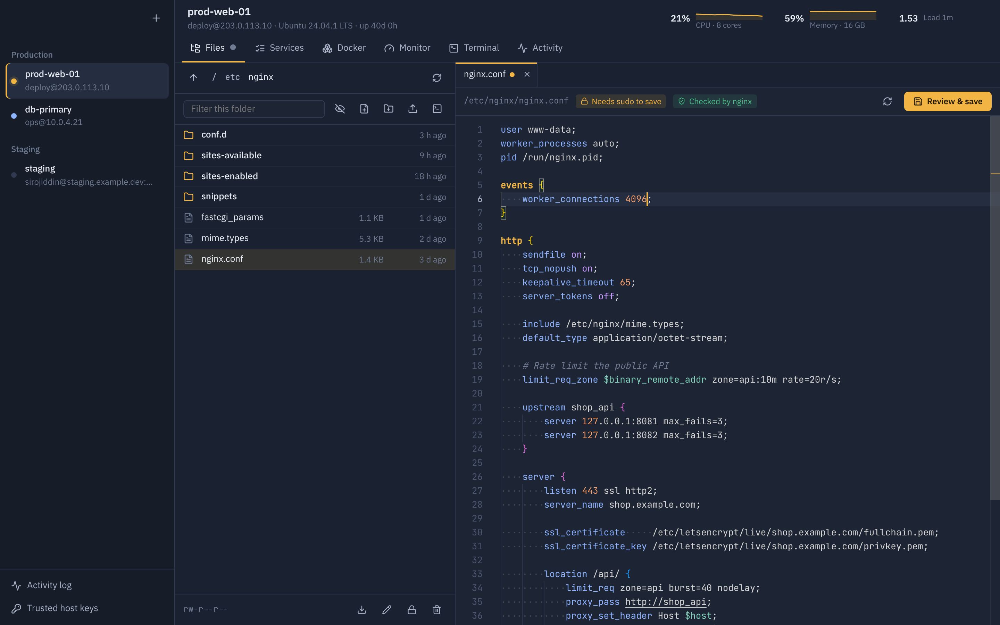
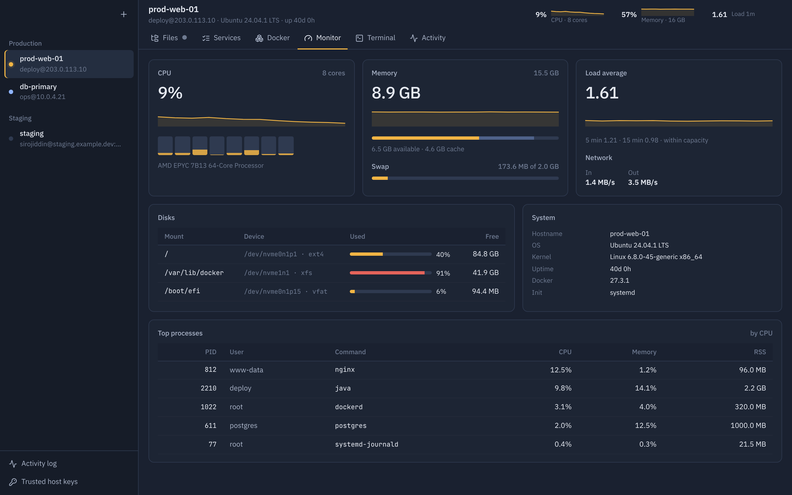

<p align="center"></p>

<h1 align="center">Orbital</h1>
<p align="center">The modern server workbench for macOS: files, configs, services, containers and a shell, over one SSH connection, with every change logged.</p>



Cyberduck is good at moving files. Real server work is more than that: you edit `nginx.conf`, run `nginx -t`, reload, check the logs, restart a container, then open Terminal anyway. Orbital does all of that in one window, and makes the risky parts safe.

## What it does

| | |
|---|---|
| **Files over SFTP** | Browse, upload files and whole folders (or drag from Finder), download, rename, chmod and delete. Copy a file or folder straight from one connected server to another. Streaming transfers. Symlinked folders open like regular ones. |
| **FTP, WebDAV and S3 too** | Connect to FTP and FTPS servers, WebDAV shares (Nextcloud, ownCloud, NAS boxes) and S3 or S3-compatible storage (Amazon S3, Backblaze B2, Cloudflare R2, Google Cloud Storage, Wasabi, DigitalOcean Spaces, MinIO) with the same file browser and editor. Presets fill in endpoints and regions. |
| **Deploy** | Pull, build and restart an app in one click, fast-forward only, with live output per step; roll back to an earlier commit; every deploy kept with its log. |
| **Live logs** | Follow log files, systemd journals and container output as they are written, several at once, with search and an errors-only filter. |
| **Tunnels** | Open a server's port (a database, an admin panel) on this Mac through the SSH connection, without opening it in the firewall. |
| **A real editor** | Monaco (the VS Code editor) with syntax highlighting for 40+ languages, including a built-in nginx grammar. Detects conflicting edits: if someone changed the file on the server since you opened it, Orbital won't silently overwrite it. |
| **Safe save for configs** | For nginx, sshd, sudoers, haproxy, apache, caddy, systemd units, docker compose, fstab and JSON, Orbital shows a diff, makes a backup (`file.orbital-bak-<time>`, last 5 kept), writes in place (owner, mode and inode preserved), runs the right validator and **automatically rolls back** if it fails. Root-owned files are saved through sudo. |
| **Services** | All systemd units with state, boot setting, PID, memory, restarts and recent journal logs. Start, stop, restart, reload, enable and disable. Restarts and reloads of nginx, sshd, apache, haproxy, caddy, postfix and bind run a **pre-flight config check first**, so a typo can't take a site down or lock you out of SSH. |
| **Tabs for what the server runs** | After connecting, Orbital looks for known software (nginx, Apache, Caddy, HAProxy, Docker, PostgreSQL, MySQL, Redis, MongoDB, PHP-FPM, sshd, fail2ban, ufw, certbot, cron). The "+" button lists what it found and whether it is running; pick one to open it as a tab with its service controls, config files and logs. |
| **Nginx** | Every site in one table: domain names, ports, TLS certificate, and what each one serves (proxy target, folder or redirect), plus upstreams and all loaded config files. Shows whether the configuration is valid. "Edit configuration" opens the right file in the editor, where safe save checks it before it goes live. |
| **HTTPS certificates** | Every Let's Encrypt certificate with its domains and days left, and whether automatic renewal is set up. Request a new one through nginx, Apache, a web folder or standalone (DNS must already point at the server), test or force a renewal, delete one (refused while a site still uses it, unless you confirm). Sites in the Nginx tab without HTTPS get a "Get HTTPS certificate" button. |
| **Firewall (ufw)** | See every rule in order, add, change and delete them from a form (ports, ranges, protocol, an address or network, app profiles, a note), turn the firewall on or off. **A change that would block your own SSH connection is stopped** before it is sent, using the address and port the server actually sees. |
| **Fail2ban** | Each jail with its ban rules, what it watches, and who is banned now. Unban an address from one jail or all of them (handy when you locked yourself out from another machine), or ban one. Your own connection's address can't be banned. |
| **SSH server review** | The settings sshd really uses (`sshd -T`, after includes), checked against hardening advice: root login, password login, empty passwords, attempts per connection, X11 forwarding and more, worst first, with what to change. Plus who is logged in now. |
| **Open ports** | Every listening port with its program, PID and systemd service, whether it is reachable from the network or only from the server itself, and what the firewall does with it. Warns when Docker publishes a port past ufw. |
| **Databases** | PostgreSQL, MySQL/MariaDB and MongoDB: every database with its size, tables and connections, and a one-click backup to your Mac (made on the server, downloaded, removed from the server). Redis: memory, keys, clients and hit rate, with snapshot and flush. |
| **Apache and HAProxy** | Apache's virtual hosts, sites to enable or disable (checked with configtest first) and modules. HAProxy's frontends and backends with live server health, and draining or maintenance for a server. |
| **Cron** | Every scheduled job on the server in plain words ("every weekday at 09:00"), when it runs next and when it last ran. Add, edit, pause and delete jobs, or run one now and see its output. Systemd timers and the daily/weekly scripts too. |
| **Users** | Add server accounts with every option (password and/or SSH keys, sudo and other groups, shell, home, UID, expiry), change their groups, password and keys, lock or delete them. Orbital won't lock you out of your own account. |
| **Docker** | Containers grouped by Compose project, filtered by state and sorted by name, state, image, CPU or memory, with live CPU and memory, logs, `inspect` and the Compose file (edit it, apply with `up -d`, restart a service, pull images). Start, stop, restart, pause and remove (removing asks you to type the container name). Falls back to sudo when you aren't in the `docker` group. |
| **Monitor** | CPU (overall and per core), memory and cache, swap, load, disks, network throughput, top processes, what uses the CPU and memory (by program, service, user or process), disk usage by folder with drill-down, plus server details: OS, kernel, machine and vendor, IP addresses, gateway, DNS, time zone, pending updates, reboot needed, failed services. Agentless: nothing is installed on the server. |
| **Terminal** | A full xterm (256 colours, links, resize) over the same connection. "Open terminal here" starts a shell in the folder you're browsing. No Terminal.app or iTerm needed. |
| **Activity log** | Every change, success or failure, is recorded: who, which server, what, the exact command sent, exit code and duration. The log is append-only (enforced by the database) and **SHA-256 hash-chained**, so tampering is detectable with one click. Exports to CSV and JSON. |
| **Cyberduck-grade security** | Passwords and passphrases are saved encrypted on your Mac, readable only there, and Orbital never interrupts you with Keychain prompts. Unknown host keys need your confirmation; a changed host key is refused outright. Supports password (with keyboard-interactive fallback), private keys (OpenSSH/PEM, encrypted or not) and ssh-agent (1Password, Secretive, YubiKey). Keys in `~/.ssh/known_hosts` are trusted automatically. The sudo password goes over stdin, never on the command line and never into the log. Jump hosts (ProxyJump) with a separate host-key check and credentials per hop. **Import your `~/.ssh/config`** (following `Include`, with `ProxyJump` chains): pick hosts from a preview, nothing secret is copied. Optional Touch ID before saved credentials are used. |

<p>




</p>

| **Comfortable to use** | Light and dark theme, a ⌘K command menu, back and forward (⌘[ ⌘], two-finger swipe), resizable panels and sidebar (hide it with ⌃⌘S), and a Settings page for fonts and refresh rate. |

## Tech stack

| Layer | Choice | Why |
|---|---|---|
| App shell | **Tauri 2** (Rust + the system WKWebView) | A small native `.app` (tens of MB rather than an Electron-sized bundle). Low memory use, hardened runtime, notarizable. Windows and Linux builds come for free later. |
| Engine | **Rust** crate `orbital-core` | Memory safety for code that holds SSH sessions and secrets. No UI dependency, so it is fully testable headless. |
| SSH / SFTP | `russh` + `russh-sftp` | Pure-Rust SSH2 implementation, async (tokio), with agent support. No OpenSSL or libssh2 to ship. |
| Secrets | Encrypted vault (ChaCha20-Poly1305) in a hidden data folder | Keyed to the Mac; no Keychain prompts, even for unsigned or rebuilt apps. |
| Local data | **SQLite** (`rusqlite`, bundled) | Profiles (no secrets), pinned host keys, the audit log and settings. One file, `0600`. |
| UI | React 18 + TypeScript + Vite, Zustand; Radix Dialog, Sonner, cmdk, NumberFlow | Plain CSS with theme variables (light and dark). |
| Editor | Monaco, self-hosted | Works offline and under a strict CSP. |
| Terminal | xterm.js | |
| Type | IBM Plex Sans + JetBrains Mono, bundled | |

See [docs/ARCHITECTURE.md](docs/ARCHITECTURE.md) for how it fits together and [SECURITY.md](SECURITY.md) for the threat model.

## Download

Builds are attached to [GitHub Releases](../../releases). Until the app is signed with a Developer ID, macOS warns the first time it opens: System Settings → Privacy & Security → Open Anyway. After that Orbital updates itself: it checks for a new version at launch and every six hours, and Settings → Updates installs it with one click and a restart. How releases are made: [docs/RELEASING.md](docs/RELEASING.md).

## Getting started (macOS)

Requirements: Xcode Command Line Tools (`xcode-select --install`), Rust (`curl https://sh.rustup.rs -sSf | sh`) and Node 22+.

```bash
npm install
npm run tauri dev       # run the app with hot reload
npm run tauri build     # build Orbital.app and a .dmg into target/release/bundle/
```

To work on the UI in a plain browser with a mocked backend:

```bash
npm run demo            # http://localhost:1430
```

## Tests

```bash
cargo test -p orbital-core     # unit tests (parsers, audit chain, host-key pinning, shell quoting)
npm test                       # frontend unit tests
npm run typecheck
```

The engine also has **end-to-end tests against a real OpenSSH server**. They cover password, key and encrypted-key login, the host-key trust and MITM refusal, SFTP round trips, conflict detection, sudo, privileged safe save with rollback, metrics, the PTY terminal and audit-chain integrity:

```bash
sudo bash scripts/it-sshd.sh            # Linux / CI: starts sshd on 127.0.0.1:2222, prints env vars
export ORBITAL_IT_HOST=... (as printed)
cargo test -p orbital-core --test live_ssh -- --test-threads=1
```

FTP, WebDAV and S3 have their own live tests against throwaway local servers (pyftpdlib, WsgiDAV and moto, installed into a virtualenv; no root needed):

```bash
bash scripts/it-storage.sh              # prints the variables to export
cargo test -p orbital-core --test live_storage -- --test-threads=1
bash scripts/it-storage.sh stop
```

CI (`.github/workflows/ci.yml`) runs all of this, including the firewall and fail2ban tests against real ufw and fail2ban on a disposable runner, and builds a universal macOS `.dmg`. Pushing a tag like `v1.0.0` runs `.github/workflows/release.yml`, which builds the app, signs the update and attaches both with `latest.json` to a draft GitHub Release; `npm run release -- minor` prepares the version bump and tag.

## Contributing

See [CONTRIBUTING.md](CONTRIBUTING.md) and the [code of conduct](CODE_OF_CONDUCT.md). Report security problems privately as described in [SECURITY.md](SECURITY.md).

## Project layout

```
crates/orbital-core/   engine: ssh, sftp, metrics, services, docker, config_edit, terminal, audit, db,
                       tools, nginx, webservers, databases, users, cron, usage, firewall, fail2ban, certbot, sshd, ports, sysinfo,
                       ssh_config (import from ~/.ssh/config)
  tests/live_ssh.rs    end-to-end tests against a real sshd
src-tauri/             Tauri shell: typed commands -> Engine (no business logic)
src/                   React UI (views/, components/, lib/api.ts mirrors the Rust types)
src/demo/mock.ts       mocked backend for `npm run demo`
docs/                  architecture, roadmap, screenshots
```

## Status

Version 1.0. See [docs/ROADMAP.md](docs/ROADMAP.md).

## License

Apache-2.0
